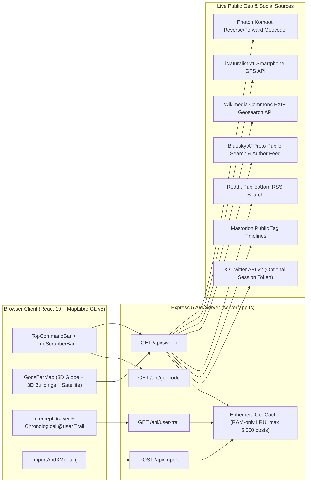

# GodsEar Architecture & System Design

## Overview

GodsEar is a spatial OSINT visualization application designed around a single question: **who posted or tweeted what, when, and where were they physically located?**

Every signal plotted on the map originates either from a live public upstream API or from a user-supplied archive export (`tweets.js`, GeoJSON, JSON, or CSV). No synthetic, sample, or jittered coordinates are ever generated, and all swept signals reside strictly in an ephemeral in-memory LRU cache (`EphemeralGeoCache`) with zero disk persistence.

## Architecture System Diagram (ASD)

## Spatial Precision Model

| Precision Level | Badge | Source Mechanism |
| :--- | :--- | :--- |
| `exact_gps` | `EXACT GPS` | Smartphone hardware GPS (`iNaturalist`), camera EXIF GPS (`Wikimedia Commons`), X `coordinates` / `geo`, or explicit `lat`/`lon` archive rows |
| `venue` | `VENUE` | Post text matched to a verified street or POI landmark resolved by Photon within the active sweep cone, or X `poi` bounding box centroid |
| `neighborhood` | `NEIGHBORHOOD` | Post matched to a verified district/suburb anchor or X neighborhood bounding box |
| `city` | `CITY` | City-wide municipal post anchored to the reverse-geocoded municipal center |

## Production Multi-Host Routing (`robertscreations.com/godsear` + `godsear.webdesigner.la`)

Like `ella-world` (`ella_world_standalone.conf`), a single native PM2 Node.js process (`godsear` defined in `/opt/godsear/ecosystem.config.cjs`, listening on `127.0.0.1:3012`) serves both subpath and dedicated-subdomain entrypoints without code duplication (`pnpm-workspace.yaml` declares `allowBuilds: { esbuild: true }` for clean headless Vite builds on pnpm v12+):

- **`https://robertscreations.com/godsear`** (and **`https://webdesigner.la/godsear`**): Proxied via `/etc/nginx/snippets/godsear_standalone.conf` (`location = /godsear`, `location ^~ /godsear/`, and `location ^~ /api/godsear/`). Express dynamically rewrites `/assets/` and `/favicon.svg` to `/godsear/assets/` and `/godsear/favicon.svg`, and the React client auto-selects `/api/godsear` via `getApiPrefix()`.
- **`https://godsear.webdesigner.la/`**: Proxied via `/etc/nginx/sites-available/godsear.webdesigner.la` directly to `127.0.0.1:3012` using `/` and `/api/*`.

## HTTP API Reference

| Endpoint | Method | Purpose |
| :--- | :--- | :--- |
| `/api/health` | `GET` | Health status, RAM cache signal count, and whether server-level `X_BEARER_TOKEN` is set |
| `/api/geocode?q=...` | `GET` | Forward-geocodes an address, street intersection, landmark, or city via Photon |
| `/api/sweep?lat=...&lon=...&radiusKm=...` | `GET` | Executes a spatial sweep (cached 3 min per sector unless `force=true`), filters by `platforms`, `exactOnly`, `q`, `from`, `to` |
| `/api/user-trail?handle=...&platform=...` | `GET` | Builds an ascending chronological movement trail (`1 → 2 → 3`) and total distance in km for an author |
| `/api/import` | `POST` | Parses X `tweets.js` (`window.YTD.tweet.part0`), GeoJSON, JSON, or CSV into ephemeral memory and returns bounding box |
| `/api/cache` | `DELETE` | Clears all ephemeral in-memory signals immediately |
